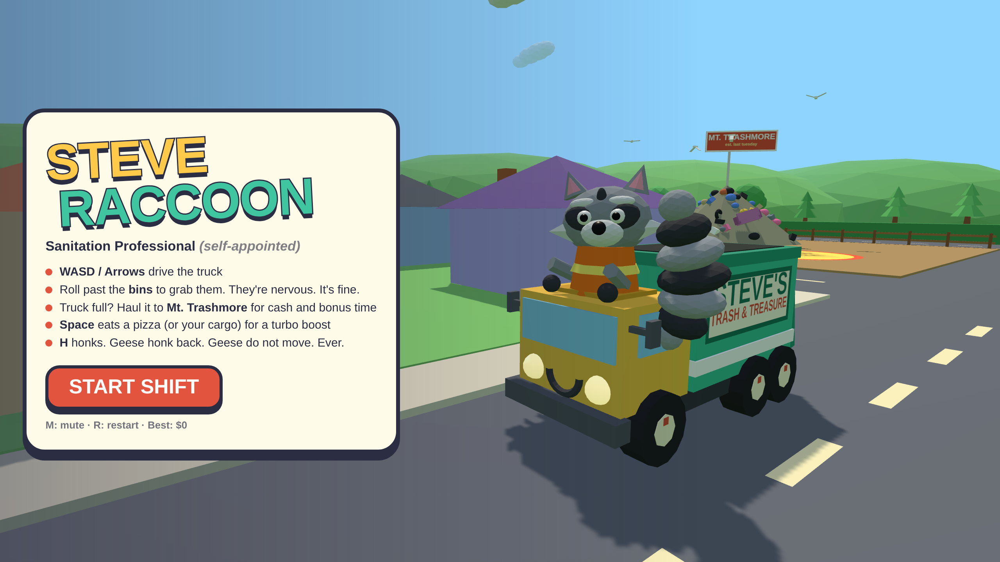
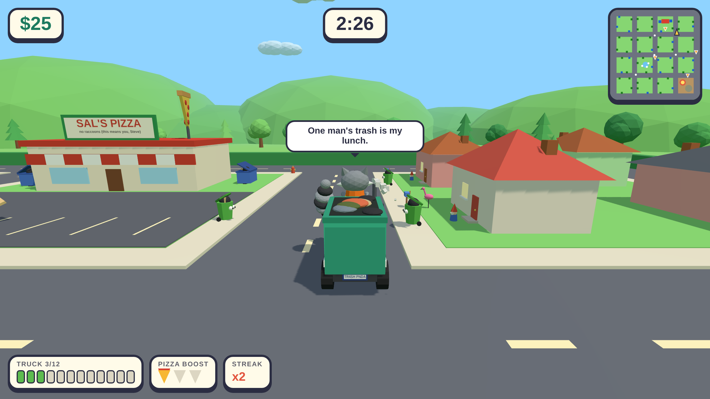
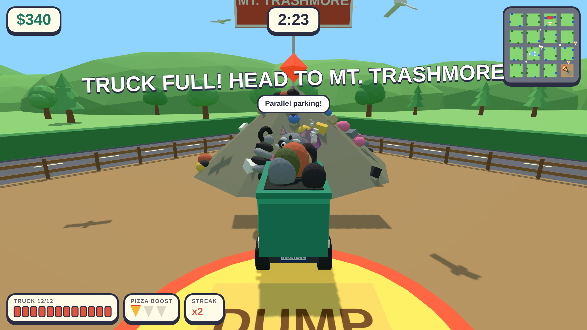
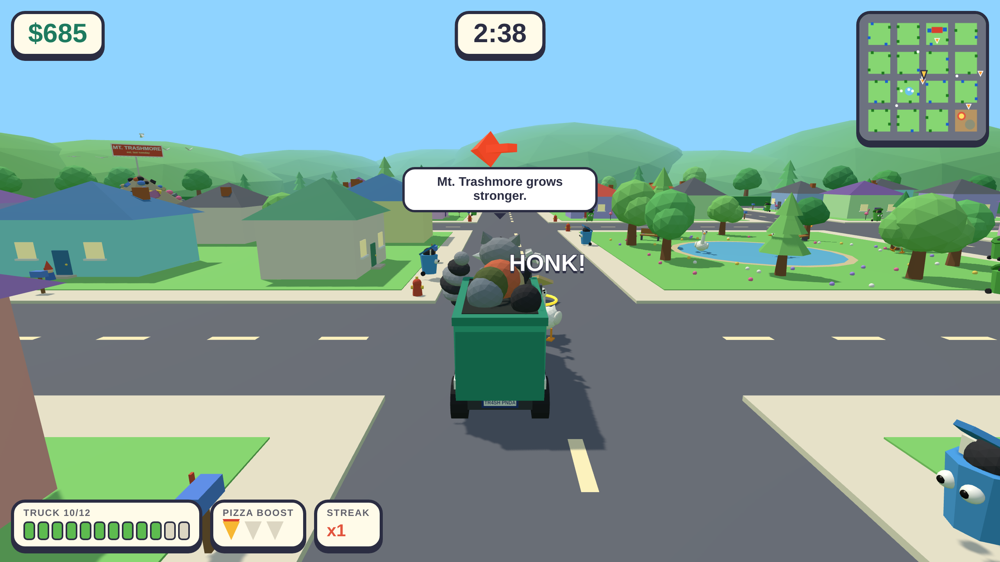
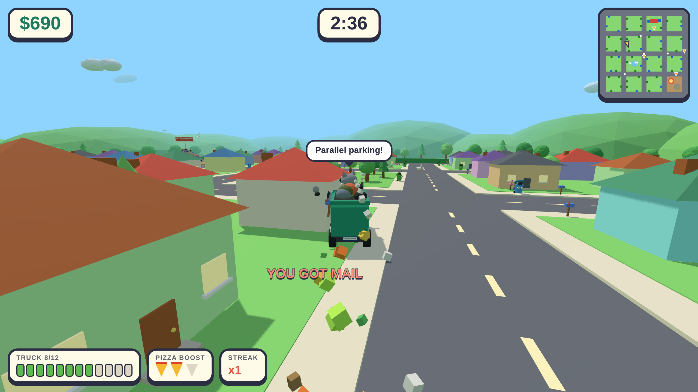
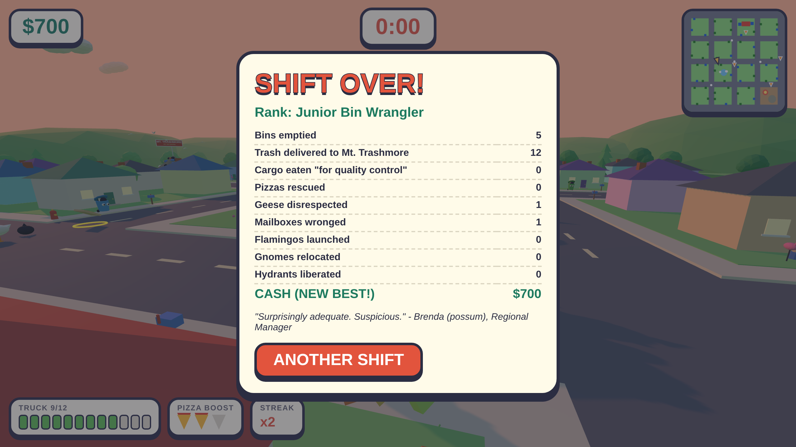

# Steve Raccoon

A small, silly 3D game about a raccoon named Steve who has appointed himself the town's sanitation professional.



## How to play

Drive the trash truck around Binsville, empty the (nervous) bins, and haul the load to **Mt. Trashmore** before your shift runs out.

| Key | Action |
| --- | --- |
| `W` `A` `S` `D` / arrows | Drive |
| `Space` | Eat a pizza for a turbo boost. No pizza? Steve eats the cargo instead. |
| `H` | Honk (the geese honk back) |
| `M` / `R` | Mute / restart shift |

- Bins you pass are grabbed automatically. Chain them quickly to build a tip **streak**.
- The truck holds 12 units. Blue recycling bins are worth 2, Sal's dumpsters are worth 4.
- Dumping pays $20 per unit and adds time to the shift. A completely full load earns a $100 bonus.
- Pizza boxes on the road are worth $25 and a boost charge.
- Geese do not move. Hitting one spills your cargo. The goose is fine. The goose is always fine.
- Mailboxes, flamingos, gnomes and hydrants are not worth points, but Brenda in HR is counting.

On-screen buttons appear on touch devices.

## Running it

No build step. Serve the folder with any static file server and open it in a browser:

```bash
python3 -m http.server 8000
```

Then visit <http://localhost:8000>.

## Screenshots







## Tech

Plain JavaScript modules and [three.js](https://threejs.org) (vendored in `vendor/`, MIT licensed). All models are built from primitives in code and all sound is synthesized with WebAudio, so there are no asset files.
